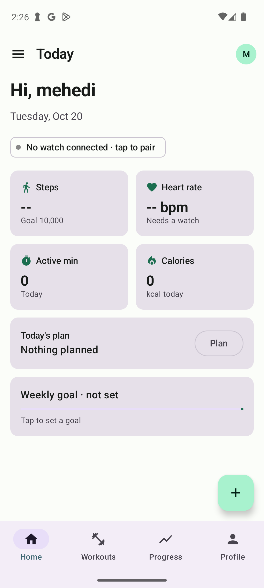

# Sprint 2: App Shell (Home, Navigation, Profile)

**Project:** Fitness Tracker (Android Development, Fall 2026)
**Team:** MD Mehedi Hasan & Mohammed Mustafa Siddiq
**Wireframe screens covered:** S5 Home, S6 Navigation drawer, S7 Start Workout sheet, S28 Profile & Settings, S29 Log out dialog (and the S31 empty state on the Workouts tab)
**GitHub issue:** [#2 Sprint 2: App shell](https://github.com/MDMEHEDIHASA/Fitness-app-26/issues/2)
**Branch:** `sprint-2`
**Status:** Built and running on the emulator. Waiting for sprint review.



---

## 1. Sprint goal

Replace the temporary Sprint 1 Home screen with the real app shell that every later screen lives inside:

1. A **Home dashboard** that matches S5.
2. **Bottom tabs** (Home, Workouts, Progress, Profile) and a **hamburger drawer** (Goals, Reminders, Smartwatch, Settings, Help, Log out).
3. The **+ button** that opens the Start Workout sheet (S7).
4. A working **Profile & Settings** screen (S28) where the user edits their name and body stats, units, and default rest timer, all saved to Firestore.
5. A **log-out confirmation** (S29).

Screens that belong to later sprints (Progress, Goals, Reminders, Smartwatch, the workout screens) already exist as **"Coming in Sprint N"** pages, so every button in the app goes somewhere.

---

## 2. What changed at a glance

| Area | New / changed files |
|---|---|
| Data | `UserProfile.kt` (settings fields), **`Units.kt`**, **`BodyStatsValidator.kt`**, `UserRepository.kt` (live profile + updates), `AuthRepository.kt` (`updateDisplayName`) |
| Navigation | `Routes.kt` (main routes), `AppNavHost.kt` (log-in screens → `MainScreen`) |
| App shell | **`ui/main/`**: `MainScreen.kt`, `AppDrawer.kt`, `BottomBar.kt`, `MainScreenScaffold.kt`, `ComingSoonScreen.kt`, `HelpScreen.kt` |
| Shared UI | **`InitialsAvatar.kt`**, **`LogOutDialog.kt`** |
| Home | `HomeScreen.kt` (rewritten), **`HomeViewModel.kt`** |
| Workouts | **`ui/workout/StartWorkoutSheet.kt`**, **`WorkoutsScreen.kt`** |
| Profile | **`ui/profile/ProfileScreen.kt`**, **`ProfileViewModel.kt`**, **`ProfileDialogs.kt`** |
| Sign up | `SignUpViewModel.kt` now uses the shared `BodyStatsValidator` |

**Bold** = new file. Total: 23 files (16 new, 7 changed).

---

## 3. Navigation structure

Sprint 1 had one flat list of screens. Sprint 2 splits the app into **two navigation levels**:

```
AppNavHost  (top level, ui/navigation/AppNavHost.kt)
├── login        S1/S2
├── sign_up      S3
├── permissions  S4
└── main  ───►  MainScreen  (ui/main/MainScreen.kt)
                 ├─ ModalNavigationDrawer (S6)
                 ├─ Scaffold with bottom NavigationBar
                 ├─ StartWorkoutSheet (S7)      ← + button
                 ├─ LogOutDialog (S29)
                 └─ inner NavHost
                     ├── home        S5          (tab)
                     ├── workouts    S31 / S17   (tab)
                     ├── progress    S19         (tab, Sprint 5)
                     ├── profile     S28         (tab)
                     ├── goals       S21         (Sprint 6)
                     ├── reminders   S23         (Sprint 7)
                     ├── smartwatch  S25/S27     (Sprint 10)
                     ├── help
                     ├── workout/strength        S9  (Sprint 3)
                     └── workout/outdoor/{type}  S13 (Sprint 8)
```

**Why two levels?**
- **Logging out is one step.** `MainScreen` and everything inside it are removed together when we navigate back to `login`. Nothing behind log-in stays on the back stack.
- **The drawer, bottom bar, + sheet and log-out dialog are written once** in `MainScreen` instead of being copied onto every screen.
- **Each tab keeps its own history.** `navigateToTab()` uses `saveState` / `restoreState`, the standard Android bottom-navigation behavior. Switching tabs and coming back returns you to where you were, and pressing Back on any tab returns to Home before leaving the app.

**When the bottom bar and drawer swipe appear:**

| Screen type | Top-left button | Bottom bar | Swipe to open drawer |
|---|---|---|---|
| Tab (Home, Workouts, Progress, Profile) | ☰ opens drawer | Shown | Yes |
| Opened from drawer or a button (Goals, Help, ...) | ← back | Hidden | No (so it doesn't clash with the Back gesture) |

`TopBarNav.Menu` and `TopBarNav.Back` in `MainScreenScaffold.kt` make each screen choose one of these.

---

## 4. Step-by-step explanation

### Step 1: Profile settings in the data model

**`UserProfile.kt`** gains two settings, both with defaults so Sprint 1 profiles still load:

| Field | Default | Used by |
|---|---|---|
| `units` | `"metric"` | Body stats display (now), distances and weights (Sprints 3–8) |
| `defaultRestSec` | `90` | Rest timer (Sprint 3, S11) |

It also has two helper properties, `firstName` and `unitSystem`. They're marked **`@get:Exclude`** so Firestore doesn't save them as extra fields. Without that, Firestore's mapper would write every getter into the document.

**Body stats are always stored in metric** (`heightCm`, `weightKg`). The unit setting only changes how they're shown and typed. This keeps the database consistent and makes later calculations (calories, BMI) simple.

### Step 2: Units (`Units.kt`)

- `UnitSystem` enum: `METRIC` ("kg / km") and `IMPERIAL` ("lb / mi"). `fromId()` falls back to metric for unknown values.
- Conversions: cm ↔ inches, kg ↔ lb.
- `formatHeight` / `formatWeight` for display: `178 cm` or `5'10"`, `76 kg` or `168 lb`.
- `heightForInput` / `weightForInput` pre-fill the Edit dialog in the user's chosen unit.

### Step 3: Shared validation (`BodyStatsValidator.kt`)

Sign Up (S3) and Edit Profile (S28) must apply the same rules, so they now live in one place:

| Field | Rule (checked in metric) |
|---|---|
| Age | 10–120 |
| Height | 50–250 cm |
| Weight | 20–400 kg |

All three stay optional (empty is allowed). `SignUpViewModel` was changed to call these functions instead of its own copy.

### Step 4: Live profile from Firestore (`UserRepository.kt`)

New functions:

| Function | What it does |
|---|---|
| `observeProfile(uid): Flow<UserProfile?>` | Wraps Firestore's `addSnapshotListener` in a Kotlin `callbackFlow`. Emits the profile immediately, then again every time it changes, on any device. The listener is removed automatically when nobody is collecting (`awaitClose`). |
| `updateBasics(uid, name, age, heightCm, weightKg)` | Writes only those fields with `SetOptions.merge()` |
| `updateUnits(uid, units)` | Writes only `units` |
| `updateDefaultRest(uid, seconds)` | Writes only `defaultRestSec` |

Because the screens **observe** the profile instead of loading it once, saving in the Edit dialog updates the Profile screen, the drawer header, and the Home greeting at the same time, with no manual refresh.

`AuthRepository.updateDisplayName()` keeps the Firebase Auth display name in sync when the user changes their name.

### Step 5: The app shell (`MainScreen.kt`)

`MainScreen` is the screen the top-level nav host shows after log-in. In order, it:

1. Gets the logged-in `uid`. If there isn't one, it calls `onLoggedOut()` and stops.
2. Creates one **`ProfileViewModel`**, shared by the drawer header and the Profile tab.
3. Creates the **inner `NavController`** and reads the current route to decide whether the bottom bar is shown.
4. Wraps everything in **`ModalNavigationDrawer`**. A `BackHandler` closes the drawer on Back, so Back doesn't leave the screen while the drawer is open.
5. Uses a **`Scaffold`** whose `bottomBar` is the `BottomBar` (only on tab routes).
6. Holds the two pieces of UI state that can be opened from several places:
   - `showStartSheet`: the + button on Home and Workouts, "Start First Workout", and "Plan"
   - `showLogOutDialog`: the drawer and the Profile screen

   Both use `rememberSaveable`, so an open sheet or dialog survives screen rotation.

**Window insets:** the app draws edge-to-edge (behind the status and navigation bars). The outer scaffold uses `contentWindowInsets = WindowInsets(0)`, and each screen's `MainScreenScaffold` does the same. The `TopAppBar` handles the status bar and the `NavigationBar` handles the gesture bar, so nothing is padded twice. Screens without a bottom bar add `navigationBarsPadding()`, so their content isn't hidden behind the gesture bar.

### Step 6: S6 Navigation drawer (`AppDrawer.kt`)

| Wireframe | Item | Goes to |
|---|---|---|
| Header | Initials avatar, name, email | — |
| — | Home | Home tab |
| ① | Goals | `goals` (Sprint 6 placeholder) |
| ② | Reminders | `reminders` (Sprint 7 placeholder) |
| ③ | Smartwatch, with an **Off** badge (**● On** once a watch is paired) | `smartwatch` (Sprint 10 placeholder) |
| ④ | Settings | Profile tab (S28 is "Profile & Settings") |
| — | Help & Feedback | `help` |
| ⑤ | Log out | Closes drawer, opens S29 |

Tapping the dimmed area, swiping left, or pressing Back closes the drawer (wireframe S6 note). The current screen's item is highlighted.

### Step 7: Bottom tabs (`BottomBar.kt`)

A Material 3 `NavigationBar` with Home, Workouts, Progress and Profile. The list `bottomTabs` is the single source of truth: `MainScreen` uses `bottomTabRoutes` to decide when to show the bar.

### Step 8: S5 Home dashboard (`HomeScreen.kt`, `HomeViewModel.kt`)

**`HomeUiState`** holds everything the screen shows. A `null` metric means "no data source yet" and is drawn as **`--`**, which is exactly how the wireframe shows missing watch data.

| Wireframe | UI | Data now | Real data arrives |
|---|---|---|---|
| ① ☰ | Opens drawer | — | — |
| Avatar (top right) | Opens Profile tab | Initials | — |
| Greeting | "Hi, {first name}" + today's date | Live from Firestore | — |
| ② Watch chip | "No watch connected · tap to pair" → Smartwatch | Always "not connected" | Sprint 10 |
| ③ Steps card | `--`, "Goal 10,000", progress bar | `null` | Sprint 9 (step counter) |
| ③ Heart rate card | `-- bpm`, "Needs a watch" | `null` | Sprints 9–10 |
| Active min / Calories | `0` | 0 | Sprint 3 (from workouts), Sprint 9 (all day) |
| ④ Today's plan | "Nothing planned" + **Plan** → Reminders | none | Sprint 7 (reminders) → shows **Start** |
| Weekly goal | "not set" + "Tap to set a goal" → Goals | none | Sprint 6 |
| ⑤ + button | Opens S7 sheet | — | — |
| ③ Card taps | Steps / HR / Active / Calories → Progress tab | — | Sprint 5 opens that metric |

**`HomeViewModel`** turns the live profile into `HomeUiState` with `map` and `stateIn(WhileSubscribed(5000))`. The 5-second window keeps the Firestore listener alive during a screen rotation instead of restarting it. `catch` turns a listener error into a safe default state instead of a crash. Later sprints will `combine` this flow with workouts, sensors and goals, without changing the screen.

### Step 9: S7 Start Workout sheet (`StartWorkoutSheet.kt`)

A Material 3 `ModalBottomSheet` (swipe down or tap outside to close).

| Wireframe | Row | Goes to |
|---|---|---|
| ① | Strength training · "Log sets, reps & weight" | `workout/strength` (Sprint 3) |
| ② | Outdoor run · "GPS route, pace, heart rate" | `workout/outdoor/RUN` (Sprint 8) |
| ② | Outdoor walk · "GPS route, steps" | `workout/outdoor/WALK` |
| ② | Cycling · "GPS route, speed" | `workout/outdoor/CYCLE` |
| ③ | From a template: "No templates yet" + **New** | `workout/strength` (templates are saved in Sprint 3) |
| — | Track heart rate with watch (toggle) | **Disabled and grayed out** with "Pair a watch to turn this on", per the S7 note |

The outdoor route uses a **navigation argument** (`{type}`), so one screen handles run, walk and cycle. `OutdoorType` is an enum, so a typo in the type can't compile.

### Step 10: Workouts tab with the S31 empty state (`WorkoutsScreen.kt`)

Nobody can save a workout until Sprint 3, so the tab shows the **S31 empty state**: icon, "No workouts yet", and **Start First Workout** (opens S7). It also has the + button from S17. Sprint 4 adds the history list and only shows this state when the list is empty.

### Step 11: S28 Profile & Settings (`ProfileScreen.kt`, `ProfileViewModel.kt`, `ProfileDialogs.kt`)

**Layout:**
- **Header:** large initials avatar, name, email.
- **Stats card:** Workouts / Streak / Total distance. These show `0` until workout history exists (Sprints 3–5). Distance shows km or mi based on units.
- **Settings rows:**

| Wireframe | Row | Action |
|---|---|---|
| ① Edit (top bar) | — | Opens **Edit profile** dialog |
| ② | Body stats · `178 cm · 76 kg · 24 yrs` | Opens Edit profile dialog |
| ② | Units · `kg / km` | Choice dialog: kg / km or lb / mi |
| ② | Default rest timer · `90 s` | Choice dialog: 30–300 s |
| ② | Goals / Reminders / Smartwatch | Navigate to those screens |
| ② | Permissions | Opens Android's **App info** page for this app (where every permission can be changed) |
| ② | Export / delete my data | Snackbar "arrive in Sprint 11" |
| ③ | Log Out | Opens S29 |

**Edit profile dialog (`EditProfileDialog`):**
- Fields: full name, age, height, weight. The labels follow the unit setting, for example "Height (cm)" or "Height (in)".
- Values are pre-filled and converted from metric for display.
- **Save** converts back to metric, validates with `BodyStatsValidator`, and shows errors under the fields. Only valid data reaches `ProfileViewModel.saveProfile()`.

**`ChoiceDialog<T>`** is one generic radio-button dialog reused for both Units and Rest timer.

**`ProfileViewModel`:**
- `profile: StateFlow<UserProfile?>`, the live profile. Shows a spinner until the first value arrives.
- `saveProfile`, `setUnits`, `setDefaultRest` each run through `runAndReport()`, which saves to Firestore and then sets a one-time **snackbar message**: "Profile updated", "Units set to lb / mi", or "Couldn't save. Check your connection and try again."
- Listener errors (for example just after signing out) are caught and logged, so they can't crash the app.

### Step 12: S29 Log out dialog (`LogOutDialog.kt`)

Text from the wireframe: *"Log out? Your workouts are saved to your account. The watch will stop syncing until you log back in."*
- **① Cancel** closes the dialog.
- **② Log Out** calls `authRepository.signOut()`, then the top-level navigator goes to S1 and clears the back stack. Pressing Back can't return to the app.

### Step 13: "Coming in Sprint N" pages (`ComingSoonScreen.kt`) and Help (`HelpScreen.kt`)

`ComingSoonScreen` shows an icon, the screen title, what it will do, and **"Coming in Sprint N"**. This makes each later sprint a drop-in replacement: the route and the buttons that lead to it already exist.

| Route | Sprint |
|---|---|
| Strength workout | 3 |
| Progress | 5 |
| Goals | 6 |
| Reminders | 7 |
| Outdoor run / walk / cycling | 8 |
| Smartwatch | 10 |

**Help & Feedback** has three short FAQs and a **Send feedback** button that opens the email app (`ACTION_SENDTO` with a `mailto:` link). If no email app is installed, it shows a toast instead of crashing.

---

## 5. Jetpack Compose concepts introduced this sprint

| Concept | Where | Purpose |
|---|---|---|
| `ModalNavigationDrawer`, `ModalDrawerSheet`, `NavigationDrawerItem` | `MainScreen`, `AppDrawer` | Hamburger drawer (S6) |
| `NavigationBar`, `NavigationBarItem` | `BottomBar` | Bottom tabs |
| Nested `NavHost` + `saveState` / `restoreState` | `MainScreen` | Separate back stack per tab |
| `currentBackStackEntryAsState()` | `MainScreen` | Know the current route to show/hide the bottom bar |
| Navigation arguments (`navArgument`) | Outdoor route | One screen for run / walk / cycle |
| `ModalBottomSheet` | `StartWorkoutSheet` | S7 sheet |
| `AlertDialog` | Log out, Edit profile, Choice dialogs | S29 and settings |
| `BackHandler` | `MainScreen` | Back closes the drawer first |
| `callbackFlow` + `stateIn` | `UserRepository`, ViewModels | Live Firestore data as Compose state |
| `FloatingActionButton` | Home, Workouts | The + button |
| `Card(onClick)`, `AssistChip`, `ListItem`, `LinearProgressIndicator` | Home, Profile | Dashboard cards and settings rows |
| `WindowInsets(0)` / `navigationBarsPadding()` | Scaffolds | Correct edge-to-edge padding |
| Generic composable `ChoiceDialog<T>` | Profile | One dialog for any list of options |

---

## 6. Firestore changes

Two new fields on `users/{uid}` (both added only when the user changes them; older documents use the defaults):

```
users / 8fJ2kd...
  fullName: "Mehedi Hasan"
  email: "mehedi@email.com"
  age: 24
  heightCm: 178
  weightKg: 76
  onboardingComplete: true
  createdAt: 1791561600000
  units: "metric"          ← new (Sprint 2)
  defaultRestSec: 90       ← new (Sprint 2)
```

No new collections. Workouts arrive in Sprint 3.

---

## 7. How to test this sprint

Run the app and log in (or sign up), then:

| # | Test | Expected result |
|---|---|---|
| 1 | Log in | Home (S5) with "Hi, {first name}" and today's date; bottom tabs visible |
| 2 | Look at the metric cards | Steps `--`, Heart rate `-- bpm` "Needs a watch", Active min `0`, Calories `0` |
| 3 | Tap the watch chip | Smartwatch "Coming in Sprint 10" page with ←; bottom bar hidden |
| 4 | Tap a metric card | Progress tab |
| 5 | Tap **Plan** on Today's plan | Reminders page |
| 6 | Tap the Weekly goal card | Goals page |
| 7 | Tap ☰ | Drawer opens with your name/email; Smartwatch shows "Off" |
| 8 | Press Back with the drawer open | Drawer closes (app stays) |
| 9 | Swipe from the left edge on a tab | Drawer opens |
| 10 | Drawer → each item | Goals / Reminders / Smartwatch / Help open; Settings opens the Profile tab |
| 11 | Tap + on Home | S7 sheet with Strength, Outdoor run, Outdoor walk, Cycling, templates, and a grayed-out HR toggle |
| 12 | Sheet → Strength / Run / Walk / Cycling | Matching "Coming in Sprint 3 / 8" page; sheet closes |
| 13 | Swipe the sheet down | Sheet closes |
| 14 | Workouts tab | "No workouts yet" + Start First Workout (opens S7) + the + button |
| 15 | Switch tabs, then press Back | Returns to Home, then a second Back leaves the app |
| 16 | Profile tab | Avatar, name, email, stats card, settings rows |
| 17 | Profile → Edit → change name and weight → Save | Snackbar "Profile updated"; Profile, drawer header and Home greeting all show the new name; Firestore `users/{uid}` updated |
| 18 | Edit → enter age `5` → Save | "10–120" under Age; nothing saved |
| 19 | Units → lb / mi | Snackbar; body stats now show `5'10"` and `168 lb`; Firestore `units: "imperial"` |
| 20 | Edit with imperial units | Labels say "(in)" and "(lb)"; saving stores metric values in Firestore |
| 21 | Default rest timer → 120 s | Row shows `120 s`; Firestore `defaultRestSec: 120` |
| 22 | Permissions row | Android App info page for Fitness Tracker |
| 23 | Export / delete my data | Snackbar "Export and delete arrive in Sprint 11" |
| 24 | Help & Feedback → Send feedback | Email app opens with the subject filled in |
| 25 | Change your name in the Firebase console | App updates within a second, without refreshing |
| 26 | Rotate with the S7 sheet or the log-out dialog open | It stays open |
| 27 | Log out from the drawer → Cancel | Dialog closes, still logged in |
| 28 | Log out from Profile → Log Out | Back to Log In; pressing Back doesn't return to the app |

---

## 8. Known limitations (planned for later sprints)

- Steps, heart rate, active minutes and calories are placeholders until **Sprints 3 and 9**.
- Profile stats (workouts, streak, total distance) are `0` until **Sprints 3–5**.
- "Today's plan" needs reminders (**Sprint 7**); the weekly goal needs goals (**Sprint 6**).
- The watch chip, drawer badge and S7 heart-rate toggle always show "not connected" until **Sprint 10**.
- No profile photo yet. The avatar shows initials (S28 mentions a photo; it can be added in **Sprint 11**).
- The Help feedback address is hard-coded to the team email in `HelpScreen.kt`.

---

## 9. Sprint review checklist

- [ ] App builds and runs from Android Studio
- [ ] Home dashboard matches S5 (with placeholders)
- [ ] Drawer (S6) opens, closes, and every item navigates
- [ ] + opens the Start Workout sheet (S7) and each option navigates
- [ ] Bottom tabs switch and Back returns to Home
- [ ] Profile (S28): edit name/body stats, units and rest timer all save to Firestore
- [ ] Log out (S29) works from the drawer and Profile
- [ ] Approved to merge `sprint-2` into `dev` and start **Sprint 3: Strength workout logging**
